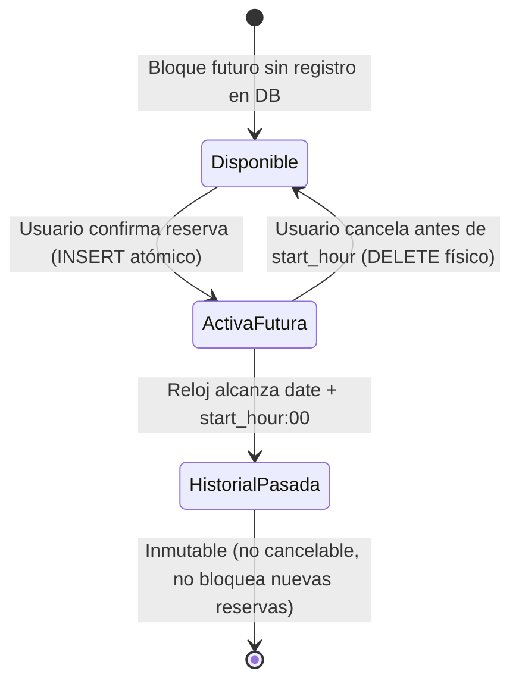

# Phase 1 Data Model: Sistema de Reservas de Canchas de Pádel

**Feature**: `001-padel-court-booking`  
**Date**: 2026-10-23  
**Database Engine**: SQLite local (`db/padel.db`) vía `better-sqlite3` (SQL puro, sin ORM)

## 1. Catálogo Cerrado de Canchas (`Court`)

Por mandato constitucional (Principio I) y `FR-004`, las 5 canchas son estáticas e inmutables. Pueden estar pre-sembradas en la tabla `courts` (o definidas como constante inmutable validada contra llave foránea/CHECK en SQLite):

| ID (`id`) | Nombre (`name`) |
| --- | --- |
| `1` | `Cancha Laureles` |
| `2` | `Cancha El Poblado` |
| `3` | `Cancha Belén` |
| `4` | `Cancha Robledo` |
| `5` | `Cancha Envigado` |

### TypeScript Interface (`PascalCase`)

```ts
export interface Court {
  id: number;
  name:
    | 'Cancha Laureles'
    | 'Cancha El Poblado'
    | 'Cancha Belén'
    | 'Cancha Robledo'
    | 'Cancha Envigado';
}
```

---

## 2. Entidad `User` (Tabla `users`)

Representa a cada jugador registrado en la plataforma (`FR-001`, `FR-002`).

| Campo | Tipo SQLite | Restricciones | Descripción |
| --- | --- | --- | --- |
| `id` | `INTEGER` | `PRIMARY KEY AUTOINCREMENT` | Identificador único del usuario |
| `email` | `TEXT` | `NOT NULL UNIQUE COLLATE NOCASE` | Correo electrónico único del usuario |
| `password_hash` | `TEXT` | `NOT NULL` | Hash seguro de la contraseña (nunca texto plano) |
| `created_at` | `TEXT` | `NOT NULL DEFAULT (datetime('now', 'localtime'))` | Fecha y hora de creación del registro |

### Reglas de Validación
- `email`: Formato de correo electrónico válido, normalizado a minúsculas (`trim().toLowerCase()`). Si ya existe en `users`, retorna `409 Conflict` o `400 Bad Request` con mensaje claro en español (`"El correo electrónico ya está registrado"`).
- `password`: Mínimo 6 caracteres al momento del registro.

### TypeScript Interface (`PascalCase`)

```ts
export interface User {
  id: number;
  email: string;
  createdAt: string;
}
```

---

## 3. Entidad `Reservation` (Tabla `reservations`)

Representa la reserva confirmada de una cancha por un usuario para una fecha y bloque de 1 hora (`FR-008` a `FR-015`). Conforme a la aclaración de `spec.md`, **las reservas canceladas se eliminan físicamente (`DELETE`)**, lo que libera de inmediato la restricción `UNIQUE(court_id, date, start_hour)`.

| Campo | Tipo SQLite | Restricciones | Descripción |
| --- | --- | --- | --- |
| `id` | `INTEGER` | `PRIMARY KEY AUTOINCREMENT` | Identificador único de la reserva |
| `user_id` | `INTEGER` | `NOT NULL REFERENCES users(id) ON DELETE CASCADE` | Usuario propietario de la reserva |
| `court_id` | `INTEGER` | `NOT NULL CHECK (court_id BETWEEN 1 AND 5)` | Identificador de la cancha (1 a 5) |
| `date` | `TEXT` | `NOT NULL` | Fecha en formato `YYYY-MM-DD` |
| `start_hour` | `INTEGER` | `NOT NULL CHECK (start_hour BETWEEN 0 AND 23)` | Hora de inicio del bloque en formato 24h (`0` = `00:00`, `14` = `14:00`, `23` = `23:00`) |
| `created_at` | `TEXT` | `NOT NULL DEFAULT (datetime('now', 'localtime'))` | Marca de tiempo de creación |

### Índices y Restricciones Críticas (SQLite DDL)

```sql
CREATE TABLE IF NOT EXISTS users (
  id INTEGER PRIMARY KEY AUTOINCREMENT,
  email TEXT NOT NULL UNIQUE COLLATE NOCASE,
  password_hash TEXT NOT NULL,
  created_at TEXT NOT NULL DEFAULT (datetime('now', 'localtime'))
);

CREATE TABLE IF NOT EXISTS reservations (
  id INTEGER PRIMARY KEY AUTOINCREMENT,
  user_id INTEGER NOT NULL,
  court_id INTEGER NOT NULL CHECK (court_id BETWEEN 1 AND 5),
  date TEXT NOT NULL,
  start_hour INTEGER NOT NULL CHECK (start_hour BETWEEN 0 AND 23),
  created_at TEXT NOT NULL DEFAULT (datetime('now', 'localtime')),
  FOREIGN KEY (user_id) REFERENCES users(id) ON DELETE CASCADE,
  UNIQUE (court_id, date, start_hour)
);

CREATE INDEX IF NOT EXISTS idx_reservations_user_date
  ON reservations(user_id, date, start_hour);
```

### TypeScript Interfaces (`PascalCase`)

```ts
export interface Reservation {
  id: number;
  userId: number;
  courtId: number;
  courtName: string;
  date: string;       // "YYYY-MM-DD"
  startHour: number;  // 0..23
  timeSlot: string;   // Ej. "14:00 - 15:00"
  createdAt: string;
}

export interface TimeSlotAvailability {
  startHour: number;  // 0..23
  label: string;      // "00:00 - 01:00" .. "23:00 - 00:00"
  status: 'Disponible' | 'Reservado';
  isPast: boolean;    // true si la fecha/hora de inicio ya transcurrió
}
```

---

## 4. Ciclo de Vida y Transiciones de Estado



1. **Creación (`Disponible` → `ActivaFutura`)**:
   - Condición previa 1: El usuario tiene sesión activa (`401` si no).
   - Condición previa 2: `date` y `start_hour` son estrictamente posteriores a la fecha y hora actual (`400` si `date < today` o `(date == today && start_hour <= currentHour)`).
   - Condición previa 3 (atómica en transacción): El usuario no tiene ninguna otra fila en `reservations` con `(date > today) OR (date == today AND start_hour > currentHour)` (`409` si ya tiene una reserva activa).
   - Condición previa 4 (atómica en transacción): No existe ninguna fila en `reservations` para `(court_id, date, start_hour)` (`409` si ya fue reservada).
2. **Transición por tiempo (`ActivaFutura` → `HistorialPasada`)**:
   - No requiere job en segundo plano; se calcula determinísticamente al consultar o validar comparando `(date, start_hour)` contra la fecha/hora actual del servidor.
3. **Cancelación (`ActivaFutura` → `Disponible`)**:
   - Solo permitida si `reservation.user_id === currentUser.id` y el bloque aún es futuro (`date > today` o `(date == today && start_hour > currentHour)`).
   - Ejecuta `DELETE FROM reservations WHERE id = ? AND user_id = ?`, eliminando la reserva de `"Mis Reservas"` y liberando el bloque horario de inmediato.
