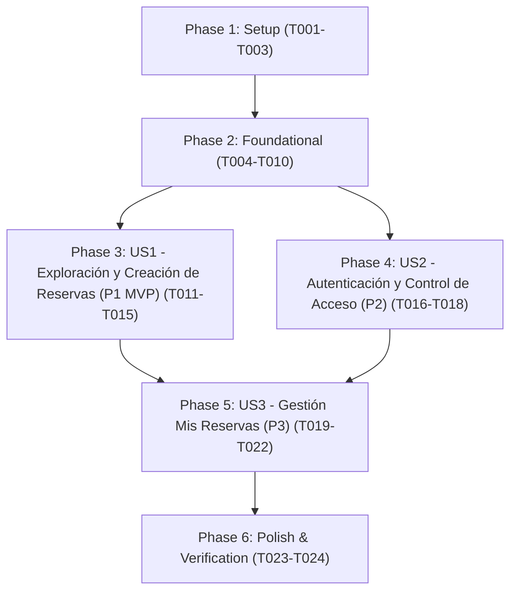

# Tasks: Sistema de Reservas de Canchas de Pádel

**Input**: Design documents from `/specs/001-padel-court-booking/`

**Prerequisites**: [plan.md](./plan.md) (required), [spec.md](./spec.md) (required for user stories), [research.md](./research.md), [data-model.md](./data-model.md), [contracts/api.md](./contracts/api.md)

**Tests**: Optional per specification; end-to-end and concurrency verification included in the Polish phase per [quickstart.md](./quickstart.md).

**Organization**: Tasks are grouped by user story (`US1`, `US2`, `US3`) to enable independent implementation and testing of each story while adhering strictly to the flat `/db`, `/backend`, and `/frontend` architecture mandated by the project constitution.

## Format: `[ID] [P?] [Story] Description`

- **[P]**: Can run in parallel (different files, no dependencies on incomplete tasks)
- **[Story]**: Which user story this task belongs to (`[US1]`, `[US2]`, `[US3]`)
- Exact file paths are included in every task description

## Path Conventions

- **Database**: `db/` at repository root (`db/schema.sql`, `db/database.ts`, `db/padel.db`)
- **Backend**: `backend/src/` and `backend/tests/`
- **Frontend**: `frontend/src/` and `frontend/src/components/`

---

## Phase 1: Setup (Shared Infrastructure)

**Purpose**: Project initialization and flat directory structure creation (`/db`, `/backend`, `/frontend`)

- [ ] T001 Create flat project directory structure (`db/`, `backend/src/`, `backend/tests/`, `frontend/src/components/`) per implementation plan in `specs/001-padel-court-booking/plan.md`
- [ ] T002 Initialize backend TypeScript project with Express, `better-sqlite3`, `cors`, and `vitest` dependencies in `backend/package.json` and `backend/tsconfig.json`
- [ ] T003 [P] Initialize frontend React + Vite + Tailwind CSS TypeScript project in `frontend/package.json`, `frontend/tsconfig.json`, `frontend/vite.config.ts`, `frontend/index.html`, `frontend/src/main.tsx`, and `frontend/src/index.css`

---

## Phase 2: Foundational (Blocking Prerequisites)

**Purpose**: Core database, shared types, auth middleware infrastructure, and base HTTP client that MUST be complete before any user story can be implemented

**⚠️ CRITICAL**: No user story work can begin until this phase is complete

- [ ] T004 Create SQLite DDL schema in `db/schema.sql` with table `users` (`id INTEGER PRIMARY KEY AUTOINCREMENT`, `email TEXT NOT NULL UNIQUE COLLATE NOCASE`, `password_hash TEXT NOT NULL`, `created_at TEXT NOT NULL DEFAULT (datetime('now', 'localtime'))`), table `reservations` (`id INTEGER PRIMARY KEY AUTOINCREMENT`, `user_id INTEGER NOT NULL REFERENCES users(id) ON DELETE CASCADE`, `court_id INTEGER NOT NULL CHECK (court_id BETWEEN 1 AND 5)`, `date TEXT NOT NULL`, `start_hour INTEGER NOT NULL CHECK (start_hour BETWEEN 0 AND 23)`, `created_at TEXT NOT NULL DEFAULT (datetime('now', 'localtime'))`, `UNIQUE (court_id, date, start_hour)`), and index `idx_reservations_user_date ON reservations(user_id, date, start_hour)`
- [ ] T005 Implement SQLite connection manager and automatic schema initialization using `better-sqlite3` (targeting `db/padel.db` with foreign keys and WAL mode enabled) in `db/database.ts`
- [ ] T006 [P] Define backend TypeScript interfaces in `PascalCase` (`Court` with union `'Cancha Laureles' | 'Cancha El Poblado' | 'Cancha Belén' | 'Cancha Robledo' | 'Cancha Envigado'`, `User`, `Reservation`, `TimeSlotAvailability`) in `backend/src/types.ts`
- [ ] T007 [P] Define frontend TypeScript interfaces in `PascalCase` (`Court`, `User`, `Reservation`, `TimeSlotAvailability`, `MyReservationsResponse`) in `frontend/src/types.ts`
- [ ] T008 Implement password hashing (`scrypt`), token signing/verification, and `requireAuth` Express middleware (returning `401 Unauthorized` with Spanish error message when session is missing or invalid) in `backend/src/auth.ts`
- [ ] T009 Setup base Express application with JSON parsing, CORS, Spanish error handling middleware (never exposing stack traces), and server entrypoint in `backend/src/app.ts` and `backend/src/server.ts`
- [ ] T010 [P] Implement functional HTTP client with `Authorization: Bearer <token>` header injection and Spanish error message extraction in `frontend/src/api.ts`

**Checkpoint**: Foundation ready — database, types, auth guard, and HTTP layer are in place; user story implementation can now begin.

---

## Phase 3: User Story 1 - Exploración de Disponibilidad y Creación de Reservas (Priority: P1) 🎯 MVP

**Goal**: Permitir a un usuario autenticado explorar las 5 canchas estáticas del club, seleccionar cualquier fecha en el calendario (incluyendo fechas pasadas en modo solo lectura), visualizar la grilla de 24 horas en bloques enteros de 1 hora (`00:00` a `23:00`) con estados `"Disponible"` y `"Reservado"`, y confirmar una reserva de 1 hora con validación atómica contra colisiones (`409 Conflict`) y límite de 1 reserva futura activa por usuario (`409 Conflict`).

**Independent Test**: Con un usuario autenticado sin reservas activas, consultar `GET /api/courts`, seleccionar `Cancha Laureles` y una fecha en `GET /api/courts/1/availability?date=YYYY-MM-DD`, confirmar un bloque futuro `"Disponible"` vía `POST /api/reservations` o desde la UI, y verificar que el bloque cambia a `"Reservado"`, que un segundo intento del mismo usuario es rechazado (`409`), y que otro usuario intentando reservar el mismo bloque recibe `409 Conflict` con `"La cancha ya fue reservada en este horario"`.

### Implementation for User Story 1

- [ ] T011 [P] [US1] Implement immutable 5-court catalog (`1: Cancha Laureles`, `2: Cancha El Poblado`, `3: Cancha Belén`, `4: Cancha Robledo`, `5: Cancha Envigado`) and 24-hour availability calculator (`0..23` blocks formatted `"00:00 - 01:00"` to `"23:00 - 00:00"`, computing `status: 'Disponible' | 'Reservado'` and `isPast: boolean` relative to local date/hour) in `backend/src/courts.ts`
- [ ] T012 [US1] Implement atomic reservation creation in `backend/src/reservations.ts` using `db.transaction(...).immediate()` to validate future date/hour (`date > today` or `date == today && start_hour > currentHour`, else `400`), enforce maximum 1 active future reservation per user (`409 Conflict`), and prevent double-booking on `(court_id, date, start_hour)` (`409 Conflict` with `"La cancha ya fue reservada en este horario"`)
- [ ] T013 [US1] Register protected endpoints `GET /api/courts`, `GET /api/courts/:courtId/availability`, and `POST /api/reservations` with `requireAuth` middleware in `backend/src/app.ts`
- [ ] T014 [P] [US1] Create functional `CourtSelector` component in `frontend/src/components/CourtSelector.tsx` allowing selection among the 5 fixed courts and any calendar date `YYYY-MM-DD` (including past dates in read-only mode)
- [ ] T015 [P] [US1] Create functional `AvailabilityGrid` component in `frontend/src/components/AvailabilityGrid.tsx` rendering the 24 hourly blocks in 24h format, disabling blocks where `isPast` is true, clearly distinguishing `"Disponible"` and `"Reservado"`, and providing a reservation confirmation action with Spanish feedback messages

**Checkpoint**: At this point, User Story 1 is complete and independently testable via API and UI components.

---

## Phase 4: User Story 2 - Autenticación y Control de Acceso de Usuarios (Priority: P2)

**Goal**: Permitir a los usuarios registrarse e iniciar/cerrar sesión con correo electrónico (`email` normalizado `trim().toLowerCase()`) y contraseña (mínimo 6 caracteres), restringiendo la visualización de disponibilidad y reservas únicamente a usuarios con sesión activa.

**Independent Test**: Registrar una cuenta nueva en `POST /api/auth/register` o desde `AuthForm.tsx`, verificar el inicio automático de sesión, cerrar sesión comprobando que la grilla de disponibilidad queda bloqueada, y volver a iniciar sesión en `POST /api/auth/login` verificando el acceso completo.

### Implementation for User Story 2

- [ ] T016 [US2] Implement `POST /api/auth/register` (validating valid email format normalized with `trim().toLowerCase()`, password minimum 6 characters, returning `409 Conflict` `"El correo electrónico ya está registrado"` on duplicate email), `POST /api/auth/login` (`401 Unauthorized` on invalid credentials), and `GET /api/auth/me` in `backend/src/auth.ts` and mount routes in `backend/src/app.ts`
- [ ] T017 [P] [US2] Create functional `AuthForm` component in `frontend/src/components/AuthForm.tsx` supporting toggle between Login and Registration, client validation, and friendly Spanish error display
- [ ] T018 [US2] Integrate session state (`token`, `user`, login, register, logout) and unauthenticated access gate in `frontend/src/App.tsx` so only authenticated users can view availability and create reservations

**Checkpoint**: At this point, User Stories 1 AND 2 work together end-to-end with full authentication and session protection.

---

## Phase 5: User Story 3 - Gestión de Mis Reservas (Futuras e Historial) (Priority: P3)

**Goal**: Proporcionar el panel `"Mis Reservas"` donde el usuario autenticado visualice sus reservas futuras activas (`date > today` o `date == today && start_hour > currentHour`) y su historial de reservas pasadas (`date < today` o `date == today && start_hour <= currentHour`) mostrando Nombre de la cancha, Fecha y Hora (24h), y pueda cancelar cualquier reserva futura propia eliminándola definitivamente (`DELETE`) para liberar su cupo y el bloque horario.

**Independent Test**: Iniciar sesión con un usuario que tenga una reserva futura y reservas pasadas, abrir el panel `"Mis Reservas"`, verificar los datos (`courtName`, `date`, `timeSlot`), cancelar la reserva futura confirmando la acción, y comprobar que desaparece de `"Mis Reservas"`, el bloque vuelve a estar `"Disponible"` en la grilla y el usuario puede reservar nuevamente.

### Implementation for User Story 3

- [ ] T019 [US3] Implement `getUserReservations` (splitting user's own rows into `upcoming` where `date > today` or `(date == today && start_hour > currentHour)` and `past` where `date < today` or `(date == today && start_hour <= currentHour)`) and `cancelReservation` (enforcing ownership `user_id = currentUser.id`, verifying future start time before `start_hour:00`, and executing physical `DELETE FROM reservations WHERE id = ? AND user_id = ?`) in `backend/src/reservations.ts`
- [ ] T020 [US3] Register protected endpoints `GET /api/reservations/my` and `DELETE /api/reservations/:id` with `requireAuth` middleware in `backend/src/app.ts`
- [ ] T021 [P] [US3] Create functional `MyReservations` component in `frontend/src/components/MyReservations.tsx` displaying upcoming active reservations (with confirmation step to cancel) and past reservation history, showing Court Name, Date (`YYYY-MM-DD`), and Time (`HH:00 - HH:00`) for every item
- [ ] T022 [US3] Add navigation between `"Explorar Canchas"` and `"Mis Reservas"` and synchronize reservation creation/cancellation state updates in `frontend/src/App.tsx`

**Checkpoint**: All three user stories (`US1`, `US2`, `US3`) are now independently functional and integrated in the UI.

---

## Phase 6: Polish & Cross-Cutting Concerns

**Purpose**: Automated verification of business rules, collision prevention, and constitutional compliance across all stories

- [ ] T023 [P] Create automated integration test suite in `backend/tests/api.test.ts` verifying: registration/login (`201`/`200`/`401`/`409`), 5-court catalog immutability, double-booking collision rejection (`409`), single active future reservation limit (`409`), past slot booking rejection (`400`), third-party cancellation rejection (`404`/`401`), and immediate slot release upon cancellation (`200`)
- [ ] T024 Validate full codebase against Constitution principles (`camelCase` variables/functions, `PascalCase` interfaces/types, zero classes, Spanish UI error messages, HTTP `400`/`401`/`409` status codes) and run end-to-end verification per `specs/001-padel-court-booking/quickstart.md`

---

## Dependencies & Execution Order

### Phase Dependencies

- **Setup (Phase 1)**: No dependencies — can start immediately (`T001` → `T002`, `T003`).
- **Foundational (Phase 2)**: Depends on Setup completion — **BLOCKS** all user stories (`T004` → `T005` → `T006`..`T010`).
- **User Story 1 (Phase 3 - P1 🎯 MVP)**: Depends on Foundational (Phase 2) completion (`T011`..`T015`).
- **User Story 2 (Phase 4 - P2)**: Depends on Foundational (Phase 2) completion (`T016`..`T018`).
- **User Story 3 (Phase 5 - P3)**: Depends on Foundational (Phase 2) and reservation creation logic from `US1` (`T019`..`T022`).
- **Polish (Phase 6)**: Depends on completion of User Stories 1, 2, and 3 (`T023`, `T024`).

### User Story Dependencies



### Parallel Opportunities

- **Setup (Phase 1)**: `T002` (backend init) and `T003` (frontend init) can run in parallel after `T001`.
- **Foundational (Phase 2)**: `T006` (`backend/src/types.ts`), `T007` (`frontend/src/types.ts`), and `T010` (`frontend/src/api.ts`) can run in parallel while `T004`–`T005` and `T008`–`T009` are built.
- **User Story 1 (Phase 3)**: Backend tasks (`T011`–`T013`) and Frontend components (`T014` `CourtSelector.tsx`, `T015` `AvailabilityGrid.tsx`) operate on separate files and can be developed in parallel.
- **User Story 2 (Phase 4)**: Backend auth endpoints (`T016`) and Frontend `AuthForm.tsx` (`T017`) can be developed in parallel before wiring `App.tsx` (`T018`).
- **User Story 3 (Phase 5)**: Backend reservation management endpoints (`T019`–`T020`) and Frontend `MyReservations.tsx` (`T021`) can be developed in parallel before wiring `App.tsx` (`T022`).

---

## Parallel Example: User Story 1

```bash
# Run backend catalog/availability logic and frontend UI components in parallel:
Task T011: "Implement immutable 5-court catalog and 24-hour availability calculator in backend/src/courts.ts"
Task T014: "Create functional CourtSelector component in frontend/src/components/CourtSelector.tsx"
Task T015: "Create functional AvailabilityGrid component in frontend/src/components/AvailabilityGrid.tsx"
```

---

## Implementation Strategy

### MVP First (User Story 1 + Auth Gate)

1. Complete **Phase 1: Setup** (`T001`–`T003`).
2. Complete **Phase 2: Foundational** (`T004`–`T010`).
3. Complete **Phase 3: User Story 1** (`T011`–`T015`) — core 5-court availability grid and collision-free booking engine.
4. Complete **Phase 4: User Story 2** (`T016`–`T018`) — full registration/login UI flow.
5. Complete **Phase 5: User Story 3** (`T019`–`T022`) — personal reservations panel and cancellation flow.
6. Complete **Phase 6: Polish** (`T023`–`T024`) — automated integration tests and quickstart validation.
